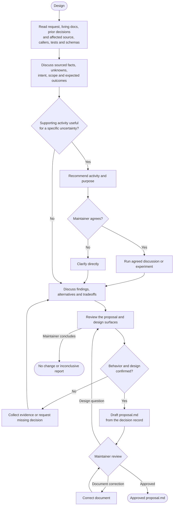

# Engineer-owned design

Use this process before a spec or its amendment. Execution determines when a spec is necessary.

Use [execution](executor.md#understand-and-decide) for decision authority and experiment rules.

The agent collects evidence, explains options and recommends decisions. The maintainer makes the decisions, including when asked to delegate judgment.

## Discovery and decisions

The diagram owns the activity order. The sections below define its decisions and completion conditions.

Ask one focused question at a time. Give a recommendation with its reason and cost, not an assumed decision.

| Supporting activity | When it helps |
| --- | --- |
| Focused grilling | Challenge assumptions, failure cases or choices during design review. |
| Domain modeling | Clarify concepts, valid states and responsibility boundaries. |
| Brainstorming | Explore an unclear problem or several plausible approaches. |
| Prototype or spike | Resolve a concrete behavior or feasibility question through an agreed experiment. |

An experiment that operates correctly is not sufficient to make sure of production readiness.

### Completion before a draft

Get explicit maintainer confirmation for each [proposal section](templates/change-spec.md) and each design surface.

Cover APIs/domain types, dependency direction/composition/external boundaries, storage/migrations, and retained/changed/retired responsibilities and contracts.

Record decisions, source evidence, approval scope and confirmed non-applicability in work state. Evidence alone does not supply confirmation.

Keep rejected and superseded choices in that record.

Reuse prior approvals only after discussing their source and continued applicability with the maintainer. Retained design can receive grouped confirmation.

Reused contracts keep their existing behavior. Missing confirmations or unresolved requirements and design choices block drafting.

Use execution's [investigation outcomes](executor.md#start) when the evidence supports no change or remains inconclusive.

## Spec preparation

Use the change template to write the confirmed design, including its technical choices, in one `proposal.md`.

Keep discovery evidence, rejected options and unchanged-surface findings in work state.

Source facts describe existing behavior. A proposed API, guarantee or migration requires a confirmed design decision, including for safety.

Get maintainer review of the draft. Separate document corrections from questions that require another design decision.

Use execution for [approval and delivery](executor.md#approvals-and-delivery).
