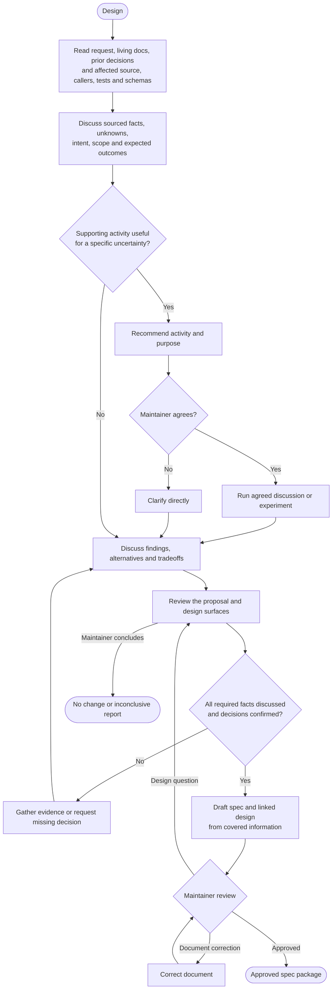
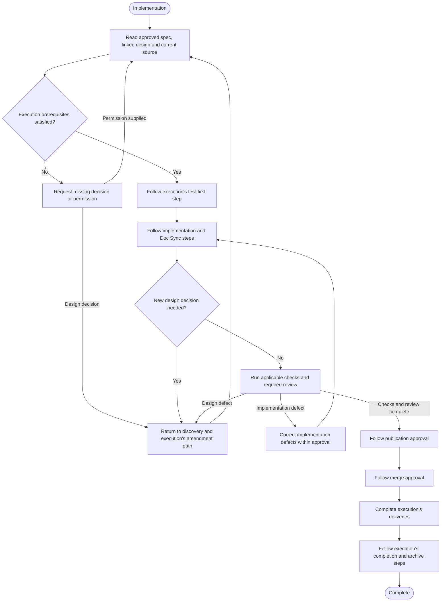

# Engineer-owned design

Use this process before a spec or its amendment. Execution determines when a spec is necessary.

Use [execution](executor.md#understand-and-decide) for general decision authority and [experiment rules](executor.md#understand-and-decide).

The agent gathers evidence, explains options and recommends decisions. The maintainer makes the decisions, including when asked to delegate judgment.

## Discovery and decisions

The diagram owns the activity order. The sections below define its decisions and completion conditions.

Ask one focused question at a time. Give a recommendation with its reason and cost, not an assumed decision.

Routine evidence-gathering choices remain with the agent.

| Supporting activity | When it helps |
| --- | --- |
| Focused grilling | Challenge assumptions, failure cases or choices during design review. |
| Domain modeling | Clarify concepts, valid states and responsibility boundaries. |
| Brainstorming | Explore an unclear problem or several plausible approaches. |
| Prototype or spike | Resolve a concrete behavior or feasibility question through an agreed experiment. |

These activities are optional, not a sequence. Supporting skills must preserve the ownership and approval rules here.

If the maintainer declines an activity, clarify directly or continue with sufficient evidence and explicit decisions.

A working experiment does not establish production readiness.

### Required design review

Present every applicable section of the [change](templates/change-spec.md) and [design](templates/design-map.md) templates for explicit confirmation.

Get confirmation when a surface does not apply. Evidence or precedent supplies facts, not permission to omit confirmation.

Retained design can receive grouped confirmation. Reuse prior approvals after discussing their source and continued applicability.

### Completion before a draft

Every spec fact must have been explicitly discussed with the maintainer. Give source evidence for technical facts.

Every requirement and design choice must have a maintainer decision or an applicable prior approval covered in that discussion.

Record discussion coverage, sources, decisions and approval scope in work state. Keep recommendations and unresolved questions there until decided.

Use execution's [investigation outcomes](executor.md#start) when the evidence supports no change or remains inconclusive.

## Spec preparation

Use the change template and linked design decision as one spec package.

Apply the pre-draft gate above to alternatives, exclusions and acceptance as well as the main design.

Populate required sections from that material. If necessary information is missing, return to discovery instead of inventing content.

Get maintainer review of the draft. Separate document corrections from questions that require another design decision.

Use execution for [approval and delivery](executor.md#approvals-and-delivery).

### Implementation handoff

This diagram is a navigation map for [execution](executor.md#implement-and-check), not another rule owner.

